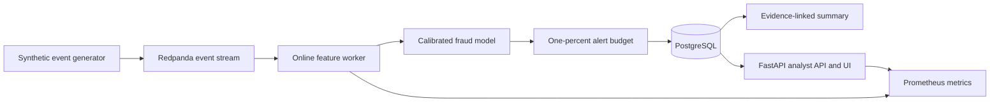

# FraudOps Streaming Platform

[](https://github.com/orhanyc/fraudops-streaming-platform/actions/workflows/ci.yml)
[](https://www.python.org/)
[](LICENSE)

A reproducible, production-style fraud detection system for synthetic payment events. It combines temporal feature engineering, calibrated machine learning, a strict analyst alert budget, Kafka-compatible streaming, evidence-linked case summaries, drift detection and an analyst API.

This is independently written portfolio software. It contains no employer code, schemas, prompts, rules, data or internal architecture.

## Measured results

The committed benchmark uses seed 42, 12,000 generated events and a chronological 60/20/20 split. Metrics describe this synthetic benchmark only.

| Metric | Logistic baseline | Calibrated challenger |
|---|---:|---:|
| Test PR-AUC | 0.9040 | **0.9967** |
| Recall at 1% alert budget | 88.2% | **100.0%** |
| Recall 95% bootstrap interval | 76.7% to 100% | **94.1% to 100%** |
| Precision at 1% alert budget | 62.5% | **70.8%** |
| Brier score, lower is better | 0.0362 | **0.0004** |

The challenger improved test PR-AUC by **0.0928**. Single-row model inference across 500 local runs measured **21.0 ms p50**, **23.4 ms p95** and **26.0 ms p99**. A 250-request sequential FastAPI benchmark completed with zero failures at **19.25 requests per second** and **59.8 ms p99**. Exact outputs are in [`reports/metrics.json`](reports/metrics.json) and [`reports/api_benchmark.json`](reports/api_benchmark.json).

Two monitoring exercises also passed:

- A payment-amount shift produced PSI 1.609 on `amount`.
- A device and location shift produced PSI 1.418 on `is_new_device` and 0.775 on `is_international`.

See [`reports/drift.json`](reports/drift.json) for all monitored features. PSI 0.20 is the demonstration threshold.

## Architecture



The default local path uses SQLite and does not require Docker. The Compose deployment switches to PostgreSQL and Redpanda without changing application code.

## What is implemented

- Reproducible behavioral payment generator with no external dataset
- Leakage-safe online features built only from earlier account events
- Chronological train, validation and test partitions
- Class-weighted logistic baseline
- Calibrated histogram gradient-boosting challenger
- Ranking at a configurable analyst alert budget
- FastAPI scoring, alert queue, health and Prometheus endpoints
- Minimal analyst UI at the API root
- Kafka-compatible producer and long-running feature/scoring worker
- SQLite and PostgreSQL persistence through SQLAlchemy
- Evidence-linked deterministic case summaries with no paid model dependency
- PSI monitoring with amount, device and location drift exercises
- Strict typing, linting, unit and integration tests, CI and secret scanning

## Quick start

Python 3.12 is required.

```powershell
python -m venv .venv
.\.venv\Scripts\python.exe -m pip install -e ".[dev]"
.\.venv\Scripts\fraudops.exe run-pipeline
.\.venv\Scripts\uvicorn.exe fraudops.api:app --reload
```

Open [http://localhost:8000](http://localhost:8000) for the analyst queue and [http://localhost:8000/docs](http://localhost:8000/docs) for the API schema.

Score a transaction:

```powershell
$body = @{
  transaction_id = "demo-001"
  timestamp = "2026-10-20T14:00:00Z"
  account_id = "acct-demo"
  counterparty_id = "cp-demo"
  device_id = "device-new"
  amount = 1250.00
  channel = "wire"
  country = "GB"
  home_country = "US"
  counterparty_age_days = 1
  scenario = "demo"
} | ConvertTo-Json

Invoke-RestMethod -Method Post -Uri http://localhost:8000/score `
  -ContentType application/json -Body $body
```

Every statement in the returned case summary links to one or more structured evidence IDs. The response does not recommend a final account or legal action.

## Streaming deployment

Generate the model artifact first, then start the API, worker, database, broker and event producer:

```powershell
.\.venv\Scripts\fraudops.exe run-pipeline
docker compose up --build
```

The generator publishes synthetic events to Redpanda. The worker maintains account history, computes online features, scores events and persists results to PostgreSQL. The API reads the ranked alert queue from the same database.

## Reproduce the quality gate

```powershell
.\.venv\Scripts\python.exe scripts\check_text.py
.\.venv\Scripts\ruff.exe check .
.\.venv\Scripts\mypy.exe src
.\.venv\Scripts\pytest.exe
.\.venv\Scripts\python.exe scripts\benchmark_api.py
```

The test suite covers generator reproducibility, chronological splits, online feature semantics, alert-budget metrics, injected drift, model serialization, storage, evidence coverage, API scoring, telemetry and event publishing. The release gate requires at least 80 percent line coverage.

## Repository map

```text
src/fraudops/            Core package, API, model and streaming worker
tests/                   Unit and integration tests
reports/                 Committed reproducible benchmark outputs
scripts/                 Text-policy and API benchmark tools
docs/                    Specification, dataset card and threat model
.github/workflows/       CI and secret scanning
compose.yaml             Redpanda, PostgreSQL, API, worker and generator
```

## Data and safety

The [dataset card](docs/DATASET.md) describes generation, splitting, leakage controls and provenance. The [threat model](docs/THREAT_MODEL.md) records current controls and production follow-up work. Synthetic scenarios are intentionally simplified and must not be interpreted as production fraud prevalence or expected bank performance.

The local analyst UI has no authentication. Do not expose it to the internet. Real deployments require identity, authorization, encrypted transport, managed secrets, artifact signing, retention controls and a formal compliance review.

## Design documents

- [Implementation specification](docs/SPEC.md)
- [Synthetic dataset card](docs/DATASET.md)
- [Threat model](docs/THREAT_MODEL.md)
- [Contributing guide](CONTRIBUTING.md)
- [Security policy](SECURITY.md)

## License

MIT
