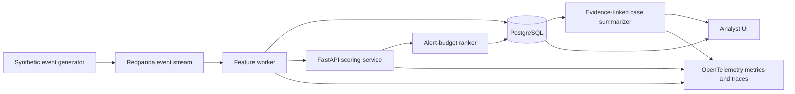

# FraudOps Streaming Platform v0.1 Specification

## Problem

A fraud operations team cannot investigate every transaction. The system must rank suspicious events quickly, keep alerts within a fixed investigation budget, and give analysts an evidence packet that separates observed facts from generated explanation.

## Users

- Fraud analyst reviewing a prioritized queue
- ML engineer measuring model and data health
- Platform engineer operating the scoring service

## Functional scope

1. Generate reproducible synthetic customers, accounts, devices and payment events.
2. Publish payment events through a Kafka-compatible local broker.
3. Compute time-window, velocity, amount, device and relationship features.
4. Train a transparent baseline and one stronger challenger model.
5. Expose online scoring through a typed FastAPI service.
6. Rank alerts to enforce a configurable 1% review budget.
7. Store events, scores, evidence and outcomes in PostgreSQL.
8. Present an analyst queue and individual case view.
9. Produce a structured case summary whose claims link to stored evidence.
10. Emit traces and metrics for throughput, latency, errors, drift and model quality.

## Non-goals for v0.1

- A production banking integration
- Real customer or employer data
- Claims of matching a commercial fraud platform
- Fully autonomous case disposition
- Paid cloud infrastructure as a prerequisite

## Initial architecture



## Data design

The generator will create behavioral profiles and labeled scenarios such as account takeover, new-device velocity, mule-like transfers and benign travel or payday spikes. Scenario names and feature definitions will be designed independently for this repository.

Train, validation and test partitions will be separated by simulated time to expose temporal drift. A second generator configuration will introduce distribution changes for monitoring tests.

## Model strategy

- Baseline: logistic regression with class weighting
- Challenger: gradient-boosted trees or a compact PyTorch model, selected after validation
- Calibration: Platt or isotonic calibration based on held-out results
- Decisioning: rank calibrated risk and select the highest-risk 1% per evaluation window

## Case-summary contract

The summarizer returns JSON with observed facts, risk signals, missing information, recommended next checks and evidence identifiers. It may not invent customer facts or recommend a final legal or account action. A deterministic template is the default path; optional model adapters are evaluated against it.

## Acceptance criteria

- A clean checkout starts locally through documented commands.
- A fixed seed reproduces dataset and evaluation results within stated tolerances.
- The challenger beats the baseline on PR-AUC or the repository transparently reports that it does not.
- Recall at a 1% alert budget is reported with confidence intervals.
- The scoring API meets a documented local p99 latency target under load.
- At least two injected drift scenarios trigger the configured detector.
- Every summary claim has evidence or is explicitly labeled as an inference.
- Tests, type checking, linting, evaluation checks and secret scanning run in CI.
- The README includes architecture, dataset provenance, results, limitations and one-command demo instructions.

## Planned repository structure

```text
fraudops-streaming-platform/
  apps/api/
  apps/analyst-ui/
  src/fraudops/data/
  src/fraudops/features/
  src/fraudops/models/
  src/fraudops/streaming/
  src/fraudops/summaries/
  src/fraudops/telemetry/
  tests/
  evaluations/
  infrastructure/
  docs/
```

## Release gate

The public repository will be created only after local validation passes, provenance is documented and a secret scan is clean. The first public tag will be `v0.1.0`.
